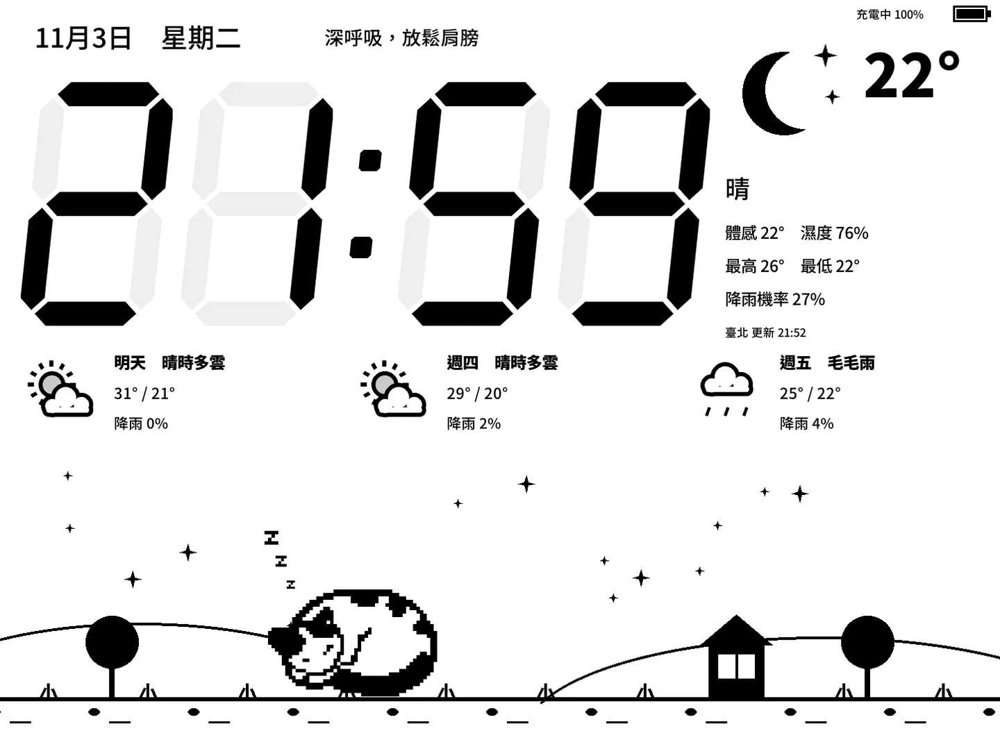
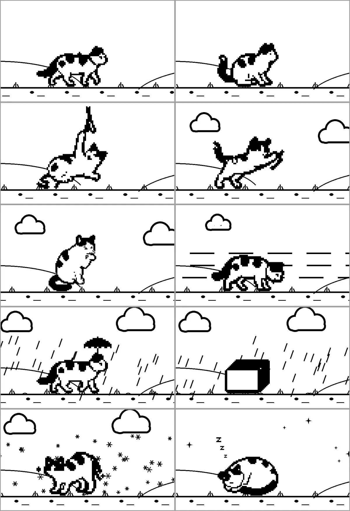
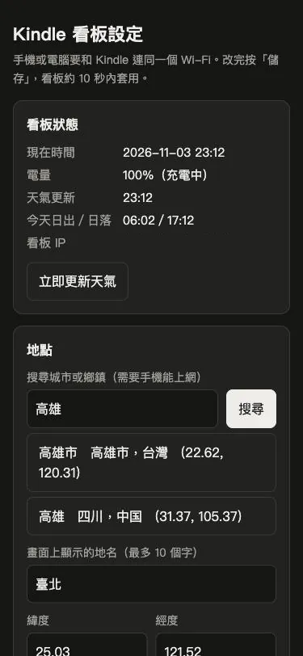
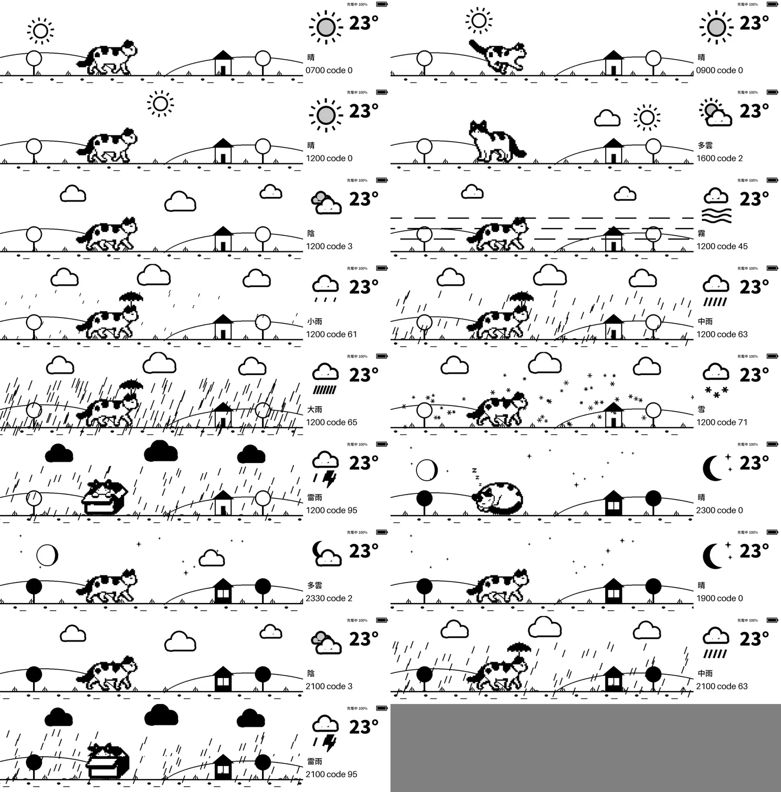
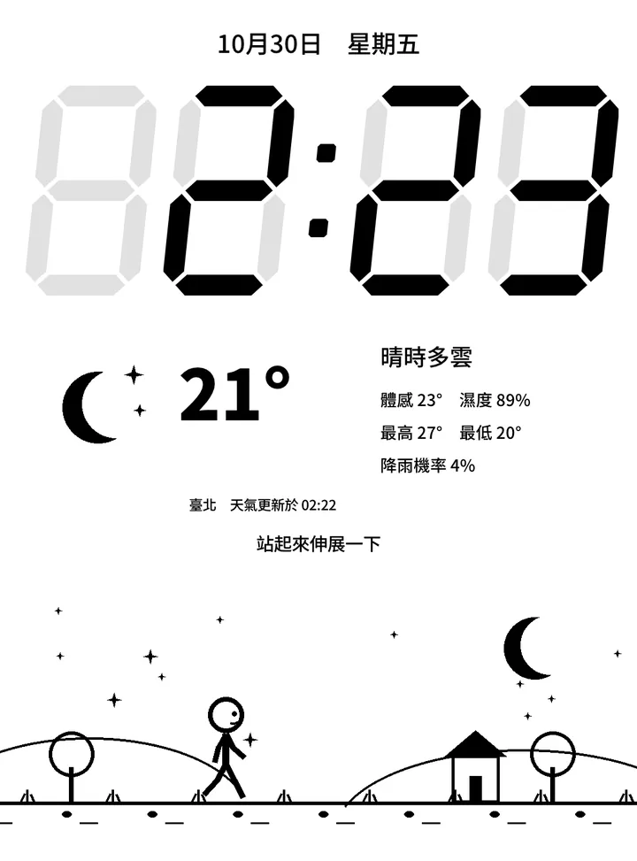

> 📦 **讀者套件**：[kindlehack-kit.zip](/assets/downloads/kindlehack-kit.zip)（約 18 MB，不含破解工具）
> 🐈 **JoJo 的像素圖來自**：[喵步鬧鐘](/posts/blog/2026-10-28-nyanpo-alarm-app-store.html)
> ⚠️ 破解會改變裝置系統、可能失去保固，請先讀文末的風險聲明。

家裡的抽屜深處，一直躺著一台 2015 年推出的 Kindle Paperwhite 3（第 7 代，Wi-Fi 版）。這台 6 吋電子書閱讀器用了很多年，翻頁跟點選選單的反應越來越慢，拿來看書已經不順手，原本已經打算把它淘汰丟掉。

不過身為生活科技老師，丟掉之前總會忍不住多看兩眼：它那塊 6 吋、解析度 1072×1448、300 ppi、支援 16 階灰階的電子紙螢幕，顯示品質其實還很好，而且電子紙只要畫面不變動就幾乎不耗電。如果不要拿它來翻書，而是把它固定在書桌插座旁，改造成一台全天候顯示時間、即時天氣、未來三天預報，還有貓咪 JoJo 散步動畫的「電子紙桌面看板」，豈不是比丟進垃圾桶更有價值？

於是從 2026 年 10 月 9 日開始評估硬體與系統環境，一路摸索、測試與調整版面，10 月 30 日完成第一版，10 月 31 日再讓背景的天氣、日夜、太陽與月亮都跟真實資料同步。為了讓國高中生活科技老師、對自造有興趣的學生與家長也能輕鬆重現，我把所有做好的腳本、圖檔與字型全部打包成 [`kindlehack-kit.zip`](/assets/downloads/kindlehack-kit.zip)（約 18 MB，文末也有連結）。不用寫任何程式，只照這篇文章就能從頭做完！

先來看看改造完成之後，擺在書桌上實際運作的橫式看板畫面：

*改造完成後的 Kindle Paperwhite 3 橫式電子紙看板，左側為大型七段顯示時鐘與日期提醒，右側與中間顯示即時天氣、電量與未來三天預報，底部則是每秒更新一格、貓咪 JoJo 隨真實天氣散步玩耍的動畫（這張是多雲的晚上：房子和樹變成剪影，月亮還沒升起）。*

整個畫面轉成 1448×1072 的橫式配置，左上角有日期、星期與每小時換一句的提醒，左側是醒目的大型七段顯示時鐘，右側與中間排列著目前天氣圖示、溫度、天氣、體感溫度、濕度、今日最高最低、降雨機率、更新時間、右上角電量與未來三天預報；最特別的是畫面底部有一條 1448×420 的動畫，主角是我們家的黑白貓 JoJo。JoJo 去當貓天使之後，我在另一個 App「喵步鬧鐘」裡為牠畫了一套像素圖，這次也讓牠住進這台 Kindle，每天在書桌上散步：牠會隨著真實天氣（晴、晴時多雲、陰、霧、毛毛雨、中雨、大雨、雪、雷雨，各有白天與晚上版本）散步，走一段就停下來玩——晴天追蝴蝶、玩逗貓棒、衝刺，陰天玩毛線球、理毛，霧天吃飯，下雨撐著小雨傘、躲進紙箱，打雷時躲進箱子蓋起來，下雪伸懶腰，夜裡縮成一團睡覺，以約每秒一格的速度在電子紙上活動。圖就是喵步鬧鐘裡那一套，轉成純黑白、外圍補一圈黑框後放大。

*JoJo 的十個動作（由左而右、由上而下）：晴天散步、追蝴蝶、玩逗貓棒；陰天玩毛線球、理毛；霧天吃飯；雨天撐小雨傘、躲紙箱；下雪伸懶腰；晚上縮成一團睡覺。*

> **可以直接拿去上課的觀念一**：淘汰的電子產品不一定是壞掉，常常只是「不適合原本的用途」。先列出它還剩下的能力（這台是 300 ppi 的電子紙、Wi-Fi、Linux），再替這些能力找新工作，就是一個完整的再設計題目。

---

## 準備材料

在動手之前，請先確認手邊的裝置與材料是否齊全：

1. **適用機型**：**Kindle Paperwhite 3（第 7 代，2015，Wi-Fi 版，平台 Wario）**。其他機型的破解方法不同，看板程式的螢幕座標也不同，不能直接套用。
2. **電腦**：Windows 或 Mac 電腦皆可。
3. **可傳資料的 USB 線**：用來把 Kindle 接上電腦傳輸檔案（有些線只能充電，無法傳資料）。
4. **Wi-Fi**：破解過程與看板抓取天氣、網路對時都需要連上 Wi-Fi。
5. **看板套件 `kindlehack-kit.zip`**：[按這裡下載](/assets/downloads/kindlehack-kit.zip)（約 18 MB）。內含看板程式、圖檔與字型，不含破解工具與遠端登入功能。

---

## 教學步驟：步驟 0～6 完整操作指南

以下步驟請依序操作，每一個檔名、資料夾路徑、網址、書庫裡的腳本名稱以及設定項目與數值都請照著核對。

### 步驟 0：備份

動手前先把原本的資料備份到電腦保存：

1. Kindle 用 USB 接電腦，出現名為 `Kindle` 的磁碟。
2. 把整個 `documents` 資料夾複製到電腦保存。

### 步驟 1：確認機型與韌體

1. **序號**：Kindle 上點選「設定 → 裝置選項 → 裝置資訊（Device Info）」可看到序號；PW3 的序號以 `G090` 開頭（例如 `G090G1`、`G090G2`…）。
2. 也可以到 `kindlemodding.org` 的「Find my Jailbreak」破解精靈輸入序號，它會告訴你機型與可用的破解方式。
3. **韌體版本**：同一個「裝置資訊」頁面可看到，或在電腦上打開 Kindle 磁碟裡的 `system/version.txt`，第一行像 `Kindle 5.16.2.1.1`。
4. PW3 的最後一版韌體就是 `5.16.2.1.1`，Amazon 不會再推更新，破解窗口不會被關掉。`WinterBreak2` 支援 `5.6.1.1`～`5.16.3`（不需註冊 Amazon 帳號；舊版 WinterBreak 則需註冊 Amazon 帳號），所以任何更新到最新的 PW3 都能用。
5. 若韌體還停在出廠的 `5.6.1`，`WinterBreak2` 不適用，請到破解精靈查其他方法。

#### 第一次接上沒反應
1. 電池完全沒電時，電腦會偵測到 Kindle 但磁碟不出現。先充 10～30 分鐘，等它自己開機。
2. 一直沒有磁碟，換一條確定能傳資料的線（有些線只能充電）。

### 步驟 2：破解（WinterBreak2）

這裡我們使用 `WinterBreak2`（v1.1.0）進行破解：

1. 到 `github.com/KindleModding/Winterbreak2` 的 Releases 下載 `wb2.zip`（解開後只有一個 `winterbreak2` 資料夾，裡面是 `dialoger.html`）。
2. 解壓縮，把裡面的 `winterbreak2` 資料夾複製到 Kindle 磁碟的根目錄（與 `documents` 同一層）。
3. Mac 電腦操作注意：複製後在終端機執行 `dot_clean -m /Volumes/Kindle`，清掉 Mac 自動產生的 `._` 開頭隱藏檔。
4. 在電腦上「退出」Kindle 再拔線。
5. Kindle 連上 Wi-Fi。
6. 打開「實驗性瀏覽器」（在右上角選單，或「設定 → 裝置選項 → 進階選項」），網址輸入 `https://penguins184.xyz/wb2`。
7. 按頁面上的 `Jailbreak` 按鈕，等它跑完。
8. **成功的判斷**：再接上電腦，Kindle 根目錄會多一個 `libkh` 資料夾，裡面有 `bin/fbink`。
9. 破解呼叫的 `jb.sh` 同時會安裝 KMC（hotfix）與 `fbink` 繪圖工具、封鎖自動更新（OTA 更新），並讓 `documents` 資料夾裡的 `.sh` 檔出現在書庫，點一下就會執行（之後的安裝都靠這個功能）。

### 步驟 3：安裝看板套件

1. 解壓縮 [`kindlehack-kit.zip`](/assets/downloads/kindlehack-kit.zip)。
2. 把 `kdash` 資料夾整個複製到 Kindle 根目錄。
3. 把套件 `documents` 裡的 4 個 `.sh` 檔複製到 Kindle 的 `documents` 資料夾。
4. Mac 電腦操作注意：再跑一次 `dot_clean -m /Volumes/Kindle`（否則書庫會多出 `._` 開頭、點了會出錯的項目）。
5. 在電腦上退出 Kindle、拔線。
6. 書庫會出現 4 個腳本項目：**`看板 啟動`**、**`看板 開機自動啟動`**、**`看板 停用自動啟動`**、**`看板 診斷`**。沒看到就重開機一次。

### 步驟 4：設定地點與方向（可先跳過，預設臺北、橫式、USB 孔在左）

用電腦的純文字編輯器（Windows 記事本、Mac 文字編輯要切成純文字）打開 `kdash/config.sh`，可依需求修改以下設定：

1. **`LAT`、`LON`**：在 Google 地圖上對地點按右鍵，出現的兩個數字依序填入。
2. **`PLACE`**：畫面顯示的地名，最多 10 個字；繁體中文常用字（Big5 收錄的字）都顯示得出來。
3. **`ROTATE`**：`2`＝橫式、USB 孔在左；`0`＝橫式、USB 孔在右；`3`＝直式（沒有三天預報與電量）。
4. **`TOUCH_EXIT`**：`0`＝點螢幕不會離開；`1`＝點一下、5 秒內再點一下可離開。
5. **`FL_DAY`、`FL_NIGHT`**：白天與晚上的背光亮度，`0`＝關、最亮 `24`；預設白天 `0`、晚上 `15`。
6. **`WEB`**：`1`＝開啟手機設定網頁（預設，見下方「用手機改設定」）；`0`＝關閉。
7. **`REMOTE`**：保持 `0`。（我另外做了只限家中網路的遠端更新，套件不含這個功能。）
8. 存檔後在電腦上退出 Kindle、拔線即可。

### 步驟 5：啟動

1. Kindle 接上充電器（動畫一直在跑，靠電池撐不久）。
2. 在書庫點 **`看板 啟動`**：約 5 秒後原本介面消失，換成看板。
3. 想每次開機都自動進看板：先回到原本介面（見步驟 6），在書庫點 **`看板 開機自動啟動`**，上方出現 `OK: autostart ON` 即完成（系統會透過 `/etc/upstart/kdash.conf` 在 `AUTOSTART` 檔存在時啟動看板）。之後開機約 45 秒自動進看板。

### 用手機改設定（看板啟動後，不必再接電腦）

看板右上角、電量的左邊，會顯示一行「設定 http://192.168.x.x」（每台、每個家裡的數字都不一樣，路由器換了也會自動更新）。

1. 手機或電腦連上**和 Kindle 同一個 Wi-Fi**。
2. 打開瀏覽器，在網址列輸入右上角顯示的那串網址（例如 `http://192.168.1.23`），會看到「Kindle 看板設定」頁。
3. **地點**：在「搜尋城市或鄉鎮」輸入地名（例如「新營」「花蓮」），按「搜尋」，點一下正確的結果，地名和經緯度會自動填好；地名可以再改短一點。搜尋需要手機能上網，找不到時改用英文，或照步驟 4 用 Google 地圖查經緯度自己填。
4. **背光**：拖動白天、晚上兩條滑桿（0＝關，最亮 24）。
5. **畫面與更新**：畫面方向、天氣更新間隔、動畫速度、點螢幕離開。
6. 按「**儲存**」。一般設定約 10 秒內套用；改了畫面方向，看板會自己重新啟動，約 30 秒。
7. 頁面上方的「看板狀態」可以看電量、天氣更新時間、今天日出日落；「立即更新天氣」會叫看板馬上重抓一次。

*手機上的設定頁（深色模式）。搜尋「高雄」時，台灣的高雄市會排在第一個。*

**安全提醒**：設定頁沒有密碼，只開放給同一個網段的裝置，而且只能改上面這幾個設定，不能做別的事。不要在學校、咖啡店這類很多人共用的 Wi-Fi 上開著；不需要時可在 `config.sh` 把 `WEB` 改成 `0`。

### 步驟 6：回到原本的 Kindle

1. 長按電源鍵約 40 秒強制重開機（或按住直到螢幕重新開機）。
2. 開機後 45 秒內，到書庫點 **`看板 停用自動啟動`**，上方出現 `autostart OFF`。
3. 之後就是一般的 Kindle；想再用看板，隨時到書庫點 **`看板 啟動`**。

---

## 畫面說明：看板上有什麼？

看板由一支 busybox shell（`kdash.sh`）驅動，啟動時會停掉原本介面（`stop lab126_gui`）並設定 `preventScreenSaver` 防止休眠，接著用 `fbdepth` 把畫面轉成橫式 1448×1072，再由 KMC 附的 `fbink 1.25` 畫出 PNG 圖檔與 TrueType 中文字：

* **左上**：日期、星期、每小時換一句的提醒。
* **左側**：七段顯示時鐘（仿電子錶的數字），每分鐘局部刷新更新；熄滅段（未亮的筆畫）用最淺一階灰（灰階值 238）。
* **右側**：目前天氣圖示、溫度、天氣、體感溫度、濕度、今日最高最低、降雨機率、更新時間；右上角顯示設定網址（看板的 IP）與電量（電量透過 `lipc-get-prop com.lab126.powerd battLevel` 與 `isCharging` 讀取，充電中會顯示「充電中」）。
* **中間**：未來三天預報（包含天氣圖示、天氣、高低溫、降雨機率）。
* **底部**：一條 1448×420 的貓咪 JoJo 動畫，跟真實天氣與時間同步。9 種天氣（晴、晴時多雲、陰、霧、毛毛雨／小雨、中雨、大雨、雪、雷雨）各有白天與晚上版本，每種約一分鐘一輪，散步之間穿插追蝴蝶、逗貓棒、毛線球、理毛、吃飯、伸懶腰、躲紙箱、睡覺；下雨撐小雨傘，全部只有純黑純白，以 A2 刷新模式約每秒一格更新。
* **太陽與月亮**：晴和晴時多雲才看得到。太陽照當天日出到日落的進度由左（東）往右（西）走；月亮是真實月相，依估算的月出月落時間出現，還沒升起就不畫。晚上房子和樹變成剪影，窗戶亮著。

*實機測試 17 組（右邊標著假裝的時間與天氣代碼）：太陽 07:00 在左、12:00 在中、16:00 在右，會被雲擋住；23:00 的月亮是當天真實的虧凸月，19:00 月亮還沒升起就不畫；晚上房子和樹變成剪影、窗戶亮著。*

* **背光**：白天自動關閉，日落後自動打開，日出再關（日出日落時間跟天氣資料一起取得）。
* **資料更新與除殘影**：天氣每 15 分鐘更新，由 Kindle 內建 `curl 7.86` 直接抓 Open-Meteo（免註冊、免金鑰），再用 `sed` 解 JSON；每 30 分鐘整頁閃一次，清除電子紙殘影（睡眠喚醒後也會自動整頁重畫）。

---

## 完全沒電之後，時間怎麼恢復？

老 Kindle 如果電池徹底耗盡，硬體時鐘可能歸零。看板針對斷電後的時間恢復做了完整處理：

1. **開機自動網路對時**：看板開機後會自己用網路對時——先用 `ntpdate` 對標準時間，如果失敗就改讀天氣伺服器回應裡的時間，對到後立刻寫回硬體時鐘。
2. **斷網重試與定期校正**：如果剛開機時 Wi-Fi 還沒連上，系統會每分鐘重試，連上後每 6 小時校正一次。
3. **先對時再抓天氣**：之所以一定要先對時再抓天氣，是因為時間錯太多時 HTTPS 憑證檢查會失敗。
4. **實測結果**：我把時間故意改成 2010 年再啟動看板，實測約 15 秒內就自動校正並抓到天氣。

---

## 常見狀況

* **書庫看不到「看板」項目**：請先重開機；並接電腦確認 4 個 `.sh` 檔是放在 `documents` 資料夾，不是放在根目錄。
* **天氣一直顯示「讀取中」**：確認 Kindle 有連上 Wi-Fi；看板每分鐘會自動重試。
* **畫面卡住**：長按電源鍵約 40 秒強制重開機。
* **手機打不開設定頁**：確認手機和 Kindle 連的是同一個 Wi-Fi（手機不要用行動網路、也不要開 VPN）；網址前面是 `http://` 不是 `https://`；右上角顯示「Wi-Fi 未連線」時，先讓 Kindle 連上網路。
* **想看出了什麼錯**：接電腦打開 `kdash/log.txt` 查看紀錄；或在書庫點 **`看板 診斷`**，會產生 `kdash/probe.txt`（裡面包含螢幕、網路、工具資訊）。

---

## 失敗路徑：開發過程中的 8 則除錯紀錄

在改造與開發這套看板的過程中，好幾個原本以為順理成章的做法都踢到了鐵板。以下用「嘗試 → 失敗 → 改用 → 學到」四段式整理出 8 則真實踩過的失敗路徑，也很適合在生活科技課堂上和學生分享除錯思維：

### 1. 電池太空導致 USB 磁碟一直不掛載
* **嘗試**：第一次把 Kindle 接上 Mac 的 USB 線，想以只讀不寫的方式先備份 `documents/` 並檢查 `system/version.txt`。當時從 USB 描述資訊已經讀出「Amazon Kindle」裝置與序號前綴 `G090G1`，便一直等磁碟掛載。
* **失敗**：雖然 USB 有出現「Amazon Kindle」裝置，但磁碟卻一直不掛載，無法讀取檔案。
* **改用**：發現是因為電池太空，機器只停在充電狀態、根本還沒開機進系統。於是讓它充一陣子（約 10～30 分鐘），等它自己重開機、斷線重連後才掛載成功。
* **學到**：USB 硬體描述有反應不代表系統已啟動；遇到久放沒電的舊裝置，必須先充電等它真正開機進入系統，磁碟才會掛載出來。

### 2. 破解畫面沒開啟遠端登入，改用「腳本＋紀錄檔」探測
* **嘗試**：執行 WinterBreak2 破解時，原本預期破解畫面會出現遠端登入服務已啟動的提示，可以直接從電腦遠端登入 Kindle 查看環境。
* **失敗**：跑完破解後畫面上並沒有出現該提示，無法直接遠端連入。後來仔細讀它呼叫的 `jb.sh`，才發現遠端登入服務只在除錯模式才開。
* **改用**：利用 `jb.sh` 讓 `documents/` 裡的 `.sh` 變成書庫裡可點擊「腳本」的特性，改用「腳本＋紀錄檔」的方式：把診斷腳本放進 `documents/`，在書庫點一下執行、把結果寫進檔案，再用 USB 讀回來。第一次執行就順利拿到螢幕參數、觸控裝置（`event1`）、`curl` 能否連 HTTPS 等關鍵資訊。
* **學到**：不必執著於遠端連線，善用書庫可執行 `.sh` 腳本並將結果寫入文字檔（如 `kdash/probe.txt` 與 `kdash/log.txt`）的設計，反而能讓所有人在只靠一條 USB 線的情況下完成安裝與診斷。

### 3. 觸控裝置偵測的 awk 欄位比對寫錯
* **嘗試**：為了偵測觸控螢幕（`event1`）來實作點選離開功能，第一版在腳本裡用 `awk` 比對輸入裝置欄位，寫成尋找以 `event` 開頭的欄位。
* **失敗**：實測時一直找不到觸控裝置，點螢幕完全沒反應；檢查診斷輸出才發現該欄位實際內容是 `Handlers=event1`，並不是以 `event` 開頭。
* **改用**：把 `awk` 條件改用 `match()` 函式直接抓取符合 `event[0-9]+` 的字串，成功抓出 `event1`。
* **學到**：解析系統狀態文字時不能只靠猜測，必須先核對真實輸出的欄位格式，並用 `match()` 搭配正規表示式擷取目標字串才穩妥。

### 4. 雷雨和下雨的動畫差異太小，改成實心黑雲
* **嘗試**：底部 1448×420 的天氣動畫有 9 種天氣、各 12 格純黑純白（當時主角還是走路小人），一開始繪製「雷雨」和「雨」的動畫時，兩者的雲層線條畫得很接近。
* **失敗**：檢查時發現雷雨和下雨的動畫第 0 格差異不到 1%，在純黑白畫面上幾乎看不出區別，自動驗收也沒過。
* **改用**：把「雷雨」場景改成大面積的實心黑雲，拉開與一般下雨動畫的視覺差異。
* **學到**：在只有純黑與純白的 A2 刷新動畫裡，細碎線條不容易區分天氣變化，利用實心黑塊與留白的面積對比，才能一眼看懂天氣狀態。

### 5. 從直式版面改為橫式版面與調整細節
* **嘗試**：最初將看板設計為 1072×1448 的直式畫面，七段時鐘未亮的筆畫灰階設為 `225`，並開啟觸控離開功能。下圖是最早的直式版本：

*最早的直式版本：時鐘、天氣與走路小人都有了，但電源線要從下方接、擺放不方便，未亮的筆畫也偏深。*

* **失敗**：實際擺放後發現直式畫面的 USB 電源線要從下方接，擺放不方便；七段時鐘未亮的筆畫設為 `225` 看起來太深；不小心碰到螢幕就會離開看板；而且版面缺少未來幾天預報與電量資訊。
* **改用**：用 `fbdepth` 把畫面由直式改為 1448×1072 橫式，預設將 USB 孔放在左邊（`ROTATE=2`），方便接電源線；把七段時鐘未亮筆畫由 `225` 改為最淺的 `238`；關掉觸控離開（`TOUCH_EXIT=0`），加上 upstart 開機自動啟動（`/etc/upstart/kdash.conf`，`AUTOSTART` 檔存在才啟動）與睡眠喚醒後自動整頁重畫；並在橫式多出的空間加上未來三天預報與右上角電量。
* **學到**：實體自造作品必須配合真實擺放環境調整，包含電源線出線方向、遠看的灰階對比以及常駐防誤觸機制，才能真正好用。

### 6. 自己用程式畫的 JoJo「不太合理」，改用已經定稿的像素圖
* **嘗試**：想把底部的走路小人換成 JoJo，生圖額度剛好用完，就直接用程式（Python 的 PIL）畫線稿：橢圓當身體、線條當腳，花紋照照片配置。
* **失敗**：畫出來比例怪、腳像棍子，被評為「畫法不太合理」。其實 JoJo 早就在喵步鬧鐘 App 裡有一套驗收過的像素圖，我卻重畫了一隻。
* **改用**：直接拿 App 的像素圖。直接用亮度門檻切成黑白時，白色身體的輪廓會斷掉，所以外圍補一圈 1 像素黑框；各組動作原圖的縮放比例不同，再依面積換算成整數倍放大（走路 6 倍、睡覺 5 倍、理毛 4 倍），讓每個姿勢的 JoJo 一樣大、像素不變形。
* **學到**：角色已經在別的作品定稿時，先找定稿素材，不要重畫；轉換到新媒材（電子紙只有黑白）時，要補的是那個媒材缺的東西（輪廓）。

### 7. 太陽和月亮的位置組合太多，改成在 Kindle 上即時疊圖
* **嘗試**：一開始太陽、月亮跟雲一起畫死在每一格動畫裡，位置固定在右上角；晚上多雲時還會畫出太陽。
* **失敗**：想讓太陽照真實時間移動、月亮照真實月相變化，如果全部預先畫好，天氣 × 白天晚上 × 太陽位置 × 月相 × 每格動畫，圖檔數量會爆炸。
* **改用**：動畫圖只畫「天空以外」的東西，天空設成透明；Kindle 每一格先清空、畫上這一刻的太陽或月亮，再疊上動畫圖。雲、樹、貓裡面的白色不透明，所以會擋住後面的日月。實測每格只多約 33 毫秒。
* **學到**：會隨時間變的東西（日月）和會隨動畫格變的東西（貓、雨）分開成兩層，數量就從相乘變成相加。

### 8. 手機設定頁搜尋「花蓮」找不到
* **嘗試**：設定頁的地點搜尋，直接把使用者輸入的字丟給 Open-Meteo 的地名查詢。
* **失敗**：「花蓮」「臺中」「屏東」都查不到，「高雄」第一個結果還是四川的高雄。原來這個地名資料庫的收錄不一致：「花蓮市」「臺中市」才有，「宜蘭」「新營」又沒有加「市」。
* **改用**：依序試幾種寫法——原字、加「市」、臺台互換、加「縣／區／鎮／鄉」——找到台灣的結果就停，再把台灣的結果排在最前面。12 個常見地名裡找到 11 個。
* **學到**：用別人的資料庫之前，先拿自己最常用的幾筆資料實際查一次；資料不一致時，在自己這一端多試幾種寫法，比要求使用者「照正確格式輸入」好用得多。

> **可以直接拿去上課的觀念二**：組合爆量時，先問「哪些東西其實是獨立變化的」，把它們拆成不同的層。這和程式設計、也和簡報動畫、影片剪輯的圖層是同一個道理。

---

## 原理簡述：看板背後的 4 個核心設計

1. **為什麼底部動畫用純黑純白的 A2 刷新模式？**
   Kindle Paperwhite 3 的螢幕是 6 吋 1072×1448、300 ppi 的 16 階灰階電子紙。顯示 16 階灰階的刷新模式比較慢；而底部 1448×420 的貓咪動畫（9 種天氣的白天與晚上版本，各 72～80 格）需要每秒更新，因此全部採用純黑與純白設計，搭配電子紙最快的 **A2 刷新模式**，就能做到約每秒一格的流暢動畫。至於 A2 模式累積的殘影，則靠每 30 分鐘整頁閃一次來清除。
2. **為什麼要從字型抽出約 430 字並轉成 TrueType？**
   看板使用 KMC 附的 `fbink 1.25` 在畫面上繪製中文字，而 `fbink` 需要讀取 TrueType 格式字型。原始的 Noto Sans CJK TC 是包含數萬字的 OTF 格式大檔案，為了讓系統輕快運作並縮小套件體積，我們從 Noto Sans CJK TC 只抽出看板用到的字（約 430 字），並把 OTF 轉成 TrueType 給 `fbink` 用，轉出後的字型檔只有約 95 KB。
3. **為什麼開機一定要先對時、再抓天氣？**
   看板是用內建的 `curl 7.86` 透過 HTTPS 連線向 Open-Meteo 抓取天氣資料。當 Kindle 完全沒電導致硬體時鐘歸零、系統時間錯太多時（例如跳回 2010 年），HTTPS 的安全憑證有效期限檢查就會失敗，導致無法連線。因此程式開機後一定先用 `ntpdate` 或讀取伺服器回應標頭的時間完成對時並寫回硬體時鐘，之後才開始抓天氣。
4. **太陽和月亮的位置怎麼算？**
   太陽：天氣資料附有當天的日出、日落時間，現在走到哪裡（0～100%）就畫在弧線的哪裡，左邊是東、右邊是西。月亮：從一個已知的新月時刻（2000 年 1 月 6 日）算起，經過的時間除以一個朔望月（約 29.53 天）的餘數就是月相；月亮過中天的時間大約是中午 12 點加上「月相 × 24 小時」，前後約 6 小時在天上。和美國海軍天文台 10 月 31 日臺北的資料比對，月升、過中天、月落差 10～40 分鐘，亮面比例 70%（實際 69%）；差距來自公式沒有考慮月球軌道的傾斜，畫在小小的天空上看不出來。

---

## 風險聲明

破解會改變裝置的系統狀態，可能失去保固，操作不當有變磚風險，請自行評估並負責。只在自己擁有的裝置上操作。

---

## 結語

把原本因為反應變慢而準備淘汰的 Kindle Paperwhite 3 拿出來，不需要改裝硬體，只要照著上面的步驟 0～6 與文末附件 `kindlehack-kit.zip` 操作，就能讓這塊 300 ppi 的電子紙螢幕重新在書桌或教室裡發揮價值。如果你手邊也有一台序號 `G090` 開頭的舊 PW3，不妨找條能傳資料的 USB 線動手試試看！

* **下載**：[`kindlehack-kit.zip`](/assets/downloads/kindlehack-kit.zip)（約 18 MB；字型依 SIL Open Font License 1.1 轉發，授權全文在套件的 `kdash/fonts/LICENSE-OFL.txt`）
* **相關文章**：[從課堂計步器到 App Store：喵步鬧鐘的開發、上架與被退三次](/posts/blog/2026-10-28-nyanpo-alarm-app-store.html)（JoJo 的像素圖就是在這個 App 裡畫的）
